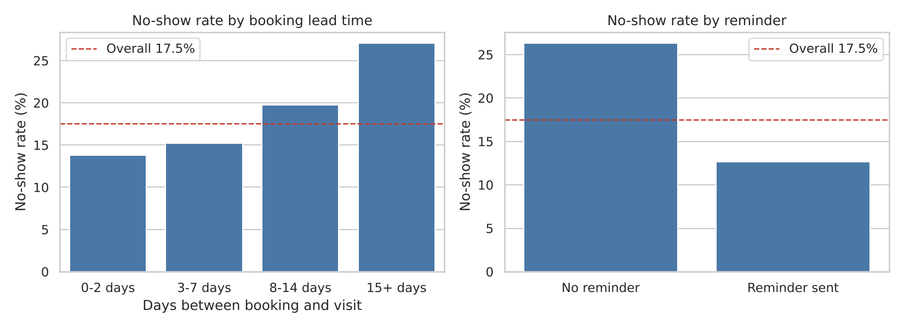
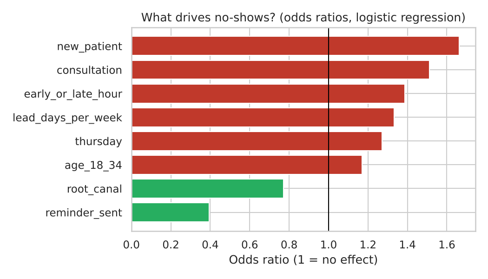
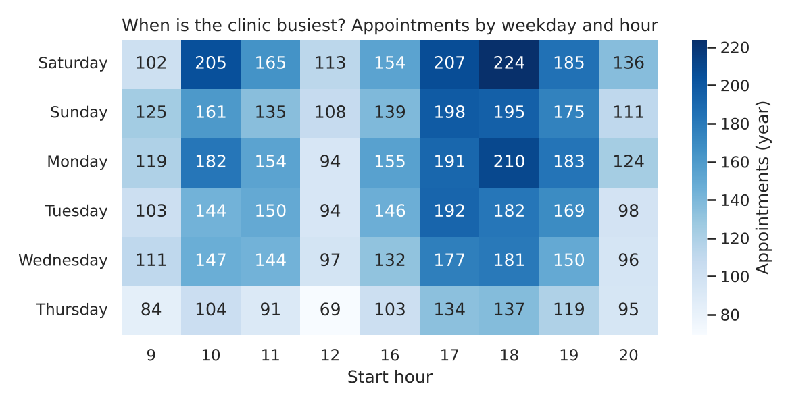

# Reducing Appointment No-Shows in a Dental Clinic (Simulated Data Analysis)

**Tools:** Python, Pandas, SciPy, scikit-learn, Matplotlib, Seaborn

## Why this project
In outpatient clinics, a missed appointment wastes a doctor's time and delays care for other patients. This project builds an end-to-end analysis of appointment no-shows: from data preparation to statistical testing, a prediction model, and practical recommendations for the clinic team.

## Data (important)
**No real patient data was used.** The dataset (`data/appointments_synthetic.csv`) is **simulated** by `generate_data.py`: 7,699 appointments over 52 weeks, 9 doctors, about 150 bookings per week. The assumptions behind the simulation are written in the code. Because the data is simulated, the *numbers* below show that the analysis pipeline works; they are not findings about any real clinic. The same code can be run on real, de-identified clinic data.

## Method
1. **Cleaning:** appointments cancelled in advance were excluded, since the slot can be re-booked. No-show = patient did not attend without cancelling.
2. **Descriptive analysis:** no-show rate by weekday, booking lead time, reminder, new vs returning patient, appointment type.
3. **Hypothesis testing:** chi-square tests of independence.
4. **Modelling:** logistic regression to estimate the effect of each factor while holding the others constant (reported as odds ratios).
5. **Scenario:** estimated no-shows avoided if every patient received a reminder.
6. **Workload:** busiest weekday/hour combinations and appointments per doctor.

## Results (on the simulated data)
- Overall no-show rate: **17.5%** (1,251 of 7,141 non-cancelled appointments).
- Appointments with a reminder: **12.6%** no-show vs **26.3%** without (chi-square p < 0.001).
- Booking lead time: **13.8%** when booked 0-2 days ahead, rising to **27.0%** when booked 15+ days ahead.
- New patients: **23.0%** vs **15.8%** for returning patients.
- Highest-risk slots: Thursdays (21.4%) and consultations (23.6%).
- Regression (odds ratios): reminder 0.39, new patient 1.66, consultation 1.51, early (9:00) or late (20:00) hours 1.39, each extra week of lead time 1.33.
- Scenario: reminders for all patients (coverage now 64%) would avoid about **346 no-shows per year (28%)** in this simulation.
- Busiest slots are weekday evenings (17:00-19:00); workload is evenly spread across the 9 doctors (about 820-910 appointments each).





## Recommendations (what a clinic could do)
1. Send a reminder for **every** appointment (SMS or WhatsApp), with a confirm/cancel option.
2. For appointments booked **more than two weeks ahead**, add a second reminder or a confirmation call.
3. Give extra follow-up to **new patients** and **consultation** bookings.
4. Allow limited, planned over-booking in high-risk slots, and keep a waiting list to fill cancelled slots.

## Limitations
- Simulated data: relationships are built into the simulation, so real-world effects may differ in size and direction.
- Association is not causation: a real study would need a comparison (for example, a pilot where some patients get reminders).
- No cost data, so the financial impact is not estimated.

## How to run
```
pip install -r requirements.txt
python generate_data.py
python analysis.py
```
Outputs: `results.txt` and the charts in `figures/`.

## Files
- `generate_data.py`: builds the simulated dataset
- `analysis.py`: full analysis and charts
- `data/appointments_synthetic.csv`: the dataset
- `figures/`: charts
